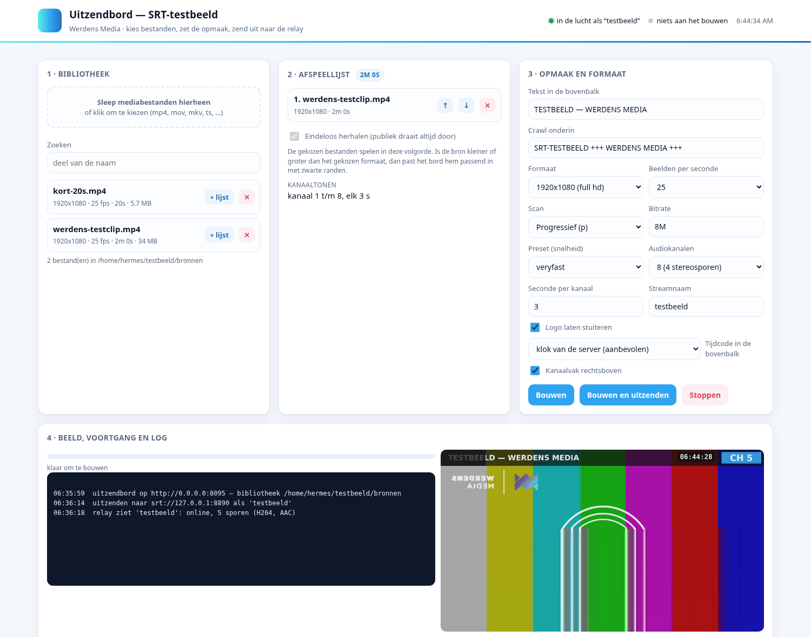
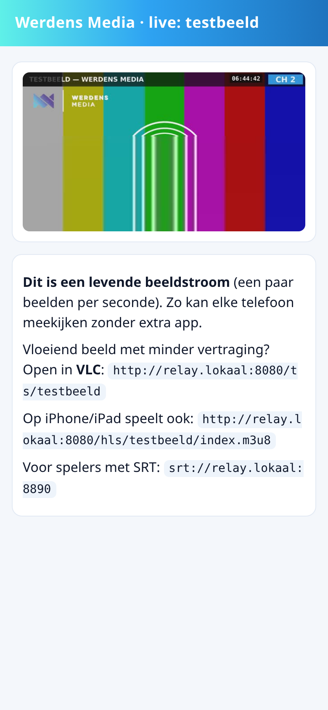

# SRT-relay / livestream-hub

Eén relay in je eigen netwerk waar elke feed naartoe kan uitzenden en waar alles
vanaf kan kijken — via SRT, RTMP, HLS of gewoon in de browser en op de telefoon.
Daarnaast een **uitzendbord**: een webpagina waarmee je bestanden kiest, een titel
en crawl klaarzet, het formaat en de tijdcode instelt en de uitzending start.

De relay is **eigen code**, geen kant-en-klare streamserver: de SRT-koppeling, het
ontleden van de MPEG-TS-stroom, het knippen in HLS-segmenten, de HLS-, TS- en
kijkroutes en de API staan allemaal in `hub/`. ffmpeg doet het rekenwerk (beeld en
geluid) en libsrt is de protocolbibliotheek — verder niets.



## Installeren (Proxmox)

Draai dit op je Proxmox-host als root. Het script maakt een Debian-container,
installeert de relay erin en **toetst hem ter plaatse** (uitzenden, terugkijken,
segmenten, momentopname, bord):

```bash
bash <(curl -fsSL https://raw.githubusercontent.com/Theberas04/srt-relay/main/srt-relay.sh)
```

Aan het eind krijg je de adressen, de poorten en het publiceerwachtwoord. Zonder
Proxmox kan het ook: zet de bestanden uit deze repo in een container of machine en
draai `bash guest-setup.sh` als root.

Instellingen (als omgevingsvariabele vóór het commando):

| Variabele | Standaard | Wat het doet |
|---|---|---|
| `CTID` | eerste vrije 130-199 | container-ID |
| `CTNAME` | `srt-relay` | hostnaam van de container |
| `SRT_PORT` | `8890` | UDP-poort voor SRT (uitzenden én kijken) |
| `HTTP_PORT` | `8080` | HTTP-poort: HLS, live TS, kijkpagina, momentopname, API |
| `RTMP_PORT` | `1935` | RTMP-poort (voor OBS) |
| `BORD_POORT` | `8095` | poort van het uitzendbord |
| `CORES` `RAM` `DISK` | `1` `512` `3` | afmetingen van de container |
| `DEBIAN` | `13` | gastversie |
| `FETCH_ONLY=1` | | alleen controleren of alle bestanden er zijn |

## Uitzenden

Vervang `192.168.1.50` door het adres dat de installer je gaf, en `<wachtwoord>`
door het publiceerwachtwoord.

```bash
# ffmpeg: een bestand naar de relay
ffmpeg -re -i film.mp4 -map 0:v -map 0:a -c copy -f mpegts \
  "srt://192.168.1.50:8890?streamid=publish:mijnstream:tom:<wachtwoord>"

# vanaf de machine met de relay zelf (de bron mag ook een camera-URL zijn)
srt-feed mijnstream /pad/film.mp4
```

- **OBS**: server `rtmp://192.168.1.50:1935/live`, sleutel
  `mijnstream?user=tom&pass=<wachtwoord>` (inloggegevens horen in de sleutel, niet
  als `user:pass@` in de server-URL — dat negeert ffmpeg's RTMP).
- **Telefoon**: een SRT-app met dezelfde URL; de naam `mijnstream` kies je zelf.
- Geef je meerdere audiosporen mee, doe dat dan met `-map 0:v -map 0:a`; zonder
  `-map` schrijft ffmpeg stil één videospoor en één audiospoor weg.

## Kijken

| Manier | Adres | Waar |
|---|---|---|
| kijkpagina | `http://192.168.1.50:8080/kijk/mijnstream` | elke browser, ook op de telefoon |
| live TS | `http://192.168.1.50:8080/ts/mijnstream` | VLC, mpv |
| HLS | `http://192.168.1.50:8080/hls/mijnstream/index.m3u8` | browsers, iPhone, spelers |
| SRT | `srt://192.168.1.50:8890` | SRT-spelers (VLC 3 kan het) |
| SRT met naam | `srt://192.168.1.50:8890?streamid=read:mijnstream` | spelers die de query meenemen |

De kijkpagina stuurt losse beelden achter elkaar (een paar per seconde). Dat is
geen luiheid: **telefoons kunnen MPEG-TS niet afspelen en Android-Chrome ook geen
HLS**, dus dit is de enige route die overal werkt zonder app. Voor vloeiend beeld
op de telefoon gebruik je de VLC-app met de TS-link of de HLS-link (iPhone).

Twee eigenaardigheden waar je tegenaan loopt:

- **VLC gooit de query uit een SRT-URL weg.** `srt://host:8890?streamid=read:naam`
  wordt in VLC gewoon `srt://host:8890`. De relay geeft een kijker zonder streamid
  daarom de lopende uitzending; daarom werkt de kale link hier wél.
- **Kijken kan zonder wachtwoord** (dat is de bedoeling: je deelt één link).
  Publiceren vraagt altijd het wachtwoord.

## Het uitzendbord

Op `http://192.168.1.50:8095` (gebruiker `tom`, het bordwachtwoord uit de
installatie). Je sleept bestanden in de bibliotheek of zet ze in
`/srv/streams/bronnen/` in de container, zet ze in de afspeellijst, en kiest:

- **formaat**: 720p of 1080p, 25 of 50 beelden per seconde, progressief of
  **interlaced** (echte 50i via veldfrequentie, voor oude decoders);
- **tijdcode**: van de serverklok (aanbevolen), meelopen met de uitzending, of uit;
- **titel en crawl** onder in beeld, en of het logo mag stuiteren;
- **bitrate en preset** (trager = minder bits of mooier beeld).

De klok van de server wordt tijdens het uitzenden in het beeld getekend; die stand
kost dus rekenkracht (ongeveer twee derde van één kern bij 1080p). De lus zelf
wordt één keer gebouwd en daarna met `-c copy` uitgezonden.



## Beheer in de container

```bash
srt-streams                       # wat staat er online, met sporen en kijkers
srt-feed <naam> <url of bestand>  # een bron naar de relay duwen
systemctl status srt-relay srt-relay-bord
journalctl -u srt-relay -n 50     # log van de hub
```

Instellingen staan in `/etc/srt-relay/relay.env` (hub) en
`/etc/srt-relay/uitzendbord.env` (bord); na wijzigen
`systemctl restart srt-relay srt-relay-bord`. De wachtwoorden staan daar ook in
(bestand met rechten 600) en blijven bij een herinstallatie bewaard.

## De relay-API

Alles wat het bord doet, kan ook met `curl`:

```bash
curl -s http://192.168.1.50:8080/api/streams            # wat staat er online
curl -s -o beeld.jpg http://192.168.1.50:8080/beeld/mijnstream.jpg
curl -N   http://192.168.1.50:8080/beeldstroom/mijnstream   # beeldstroom (MJPEG)
```

Het bord gebruikt dezelfde API (`/api/staat`, `/api/bouw`, `/api/start`,
`/api/stop`, `/api/instellingen`, `/api/upload`) met HTTP Basic-authenticatie.

## Hoe het in elkaar zit

```
hub/hub.py         de relaydienst: SRT-poort (uitzenden + kijken), RTMP-opvang,
                   fan-out naar kijkers, HLS, live TS, momentopname, beeldstroom,
                   kijkpagina en API
hub/srtkanaal.py   de SRT-koppeling: ctypes op de systeem-libsrt (geen pip nodig)
hub/tssplit.py     eigen MPEG-TS-ontleder + HLS-segmentering op keyframes
dashboard/streams.py      de ffmpeg-opdracht: bibliotheek, formaat, titel, tijdcode
dashboard/uitzendbord.py  het bord zelf (alleen de standaardbibliotheek)
dashboard/bord.html       de pagina
```

Eén SRT-poort doet alles: de `streamid` bepaalt of je publiceert of kijkt en onder
welke naam. Kijkers komen en gaan over dezelfde verbinding; over HTTP krijgt elke
kijker zijn eigen wachtrij en verzendthread, zodat een trage kijker de stroom niet
beschadigt.

## Wat er nog niet is

- **WebRTC** (beeld in de browser met heel weinig vertraging in plaats van een paar
  beelden per seconde) staat op de planning; de kijkpagina is de tussenstap.
- De relay is bedoeld voor je eigen netwerk. Van buitenaf: zet UDP `SRT_PORT` door
  naar de container. Is er CGNAT (vergelijk het WAN-adres in de router met je
  publieke IP), dan is een VPN zoals Tailscale de route.

## Testen

```bash
bash tests/test-installer.sh     # hostscript met nep-pct/pveam: 6 scenario's
python3 tests/test-dashboard.py  # het bord: opdrachtbouw, uploads, veilige paden
```

CI doet daar `bash -n`, shellcheck én een `py_compile` overheen, en haalt in een
aparte stap alle bestanden écht van `raw.githubusercontent.com` op — anders merk je
pas bij de gebruiker dat de downloadlijst niet compleet is.

## Rechten

Alle rechten voorbehouden. Wat van derden is blijft van derden: ffmpeg (LGPL/GPL)
en libsrt (MPL-2.0) vallen onder hun eigen licentie.
